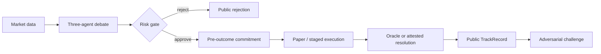

<div align="center">

# Bobby Protocol

### Verifiable decision infrastructure for autonomous finance

[](https://bobbyprotocol.xyz)
[](docs/release-readiness.md)
[](docs/audit)
[](#legacy-x-layer-archive)

**Agents promise. Bobby proves.**

</div>

> [!IMPORTANT]
> Bobby is migrating from X Layer to Base. The X Layer contracts remain a
> public historical archive. Base mainnet is **not live yet**: TrackRecord V2
> is implemented and security-reviewed, while deployment integration, Safe
> ownership, Base Sepolia rehearsal and final launch verification remain gated.
> See the [release readiness board](docs/release-readiness.md) for the current
> source of truth.

## What Bobby is

Bobby Protocol turns an AI trading opinion into an auditable process:

1. Alpha Hunter proposes a thesis.
2. Red Team attacks it.
3. CIO issues a bounded verdict and conviction score.
4. The decision is committed on-chain before the outcome.
5. The outcome is resolved into a public track record.
6. Adversaries can challenge the reasoning or a verified stop breach.

The protocol separates claims by evidence quality. Oracle-verified outcomes and
attested outcomes never share the same headline statistics.



## Release status

Status as of **2026-08-14**:

| Area | State | What it means |
|---|---|---|
| Web, MCP and debate surfaces | Live | Public product remains available during migration |
| X Layer, chain 196 | Legacy archive | Historical commitments and contracts stay readable |
| Base Sepolia, chain 84532 | Canary required | Final V2 deployment and soak are still pending |
| TrackRecord V2 | Release candidate | ABI frozen; P1 fix and mutation-sensitive invariant reviewed |
| Base mainnet, chain 8453 | **NO-GO** | Safe, deploy/verify, backend wiring and canary evidence must close first |
| Real-value execution | Gated | Current public system is paper/simulated unless explicitly labeled otherwise |

Release evidence and owner-by-owner gates live in
[`docs/release-readiness.md`](docs/release-readiness.md). This table is a
summary, not authorization to deploy.

## Trust model

### VERIFIED

TrackRecord V2 verifies entry and exit evidence through Pyth, enforces bounded
time windows and confidence, derives PnL from oracle evidence, and permits a
permissionless stop-breach challenge during finality.

### ATTESTED

Flows without supported oracle evidence can still be recorded, but they remain
in a separate ledger. Attested outcomes never increase the verified win rate.

### Legacy

X Layer records prove what was committed and resolved by the legacy contracts.
They are preserved as historical evidence and are not relabeled as
oracle-verified Base outcomes.

## Smart contracts

The Base protocol is composed of seven contracts:

| Contract | Responsibility |
|---|---|
| `BobbyTrackRecordV2` | Oracle-verified and attested decision history |
| `BobbyConvictionOracle` | Pre-outcome signal and conviction commitments |
| `BobbyAgentEconomyV2` | Protocol fees and agent-service accounting |
| `BobbyAgentRegistry` | On-chain agent identity and registration stake |
| `BobbyIntentEscrow` | Intent attestation, isolated from verified performance |
| `BobbyAdversarialBounties` | Public adversarial bounty lifecycle |
| `HardnessRegistry` | Debate difficulty and service registry |

Mainnet addresses will be published only after deployment receipts, ownership
handoff and explorer verification reconcile. Never infer an address from a
testnet manifest.

## Application architecture

| Layer | Technology |
|---|---|
| Frontend | React 18, TypeScript, Vite, Tailwind CSS, Framer Motion |
| API | Vercel serverless functions |
| Data | Supabase Postgres with RLS |
| Agent interface | MCP over Streamable HTTP and x402-style payment flows |
| Contracts | Solidity 0.8.24 and Foundry |
| Target chain | Base mainnet, chain 8453 |
| Oracle evidence | Pyth Core for supported VERIFIED markets |

Important entry points:

```text
api/agent-run.ts               main autonomous cycle
api/bobby-intel.ts             fast market snapshot
api/bobby-cycle.ts             public debate cycle
api/mcp-bobby.ts               MCP agent interface
api/bobby-protocol-stats.ts    public protocol telemetry
src/pages/BobbyProtocolLanding.tsx
src/pages/BobbyArchitecturePage.tsx
contracts/src/BobbyTrackRecordV2.sol
```

## Local development

Requirements: Node.js, npm and Foundry.

```bash
git clone https://github.com/anthonysurfermx/Bobby-Agent-Trader.git
cd Bobby-Agent-Trader
npm install
cp .env.example .env.local
npm run dev
```

Never commit `.env*`, private keys, RPC credentials, API tokens or deployment
manifests containing secrets.

### Verification

```bash
npm run check:api
npm run build
npm run test:api-security
npm run test:record-auth
npm run test:risk-gate

cd contracts
forge build --sizes
forge test --fuzz-runs 1000
bash script/check-layout.sh
```

Building successfully is required before pushing. Passing tests does not
authorize a network broadcast.

## Security and deployment policy

- Contract changes receive author review, adversarial review and independent
  diff review.
- Mainnet ownership must finish on the approved Safe; a pending handoff is not
  final ownership.
- Mainnet Pyth addresses are pinned by chain, must be distinct and must contain
  bytecode.
- Base Sepolia is rehearsed before Base mainnet, including commit, resolve,
  challenge, public readback and rollback controls.
- Production promotion is a separate human decision after CI and live-state
  verification.

Security documentation is published under [`docs/audit`](docs/audit).

## Legacy X Layer archive

The hackathon-era contracts remain available for historical verification:

| Contract | Address |
|---|---|
| `BobbyAgentEconomyV2` | [`0xD9540D770C8aF67e9E6412C92D78E34bc11ED871`](https://www.oklink.com/xlayer/address/0xD9540D770C8aF67e9E6412C92D78E34bc11ED871) |
| `BobbyConvictionOracle` | [`0x03FA39B3a5B316B7cAcDabD3442577EE32Ab5f3A`](https://www.oklink.com/xlayer/address/0x03FA39B3a5B316B7cAcDabD3442577EE32Ab5f3A) |
| `BobbyTrackRecord` | [`0xF841b428E6d743187D7BE2242eccC1078fdE2395`](https://www.oklink.com/xlayer/address/0xF841b428E6d743187D7BE2242eccC1078fdE2395) |
| `BobbyAdversarialBounties` | [`0xa8005ab465a0e02cb14824cd0e7630391fba673d`](https://www.oklink.com/xlayer/address/0xa8005ab465a0e02cb14824cd0e7630391fba673d) |

These addresses are **not** Base deployment addresses.

## Documentation

- [Architecture and system status](docs/architecture.md)
- [Base migration plan](docs/plan-migracion-base.md)
- [Mainnet release readiness](docs/release-readiness.md)
- [TrackRecord V2 integration handoff](docs/audit/trackrecord-v2-integration-handoff.md)
- [Safe setup runbook](docs/audit/safe-setup-runbook.md)
- [Security audit archive](docs/audit)

## Team

**Anthony Chavez** — Founder and lead developer<br>
[GitHub](https://github.com/anthonysurfermx) · [X](https://twitter.com/anthonysurfermx)

The protocol began during OKX X Layer Build X Season 2. That deployment is now
the public archive for Bobby's Base-first architecture.
