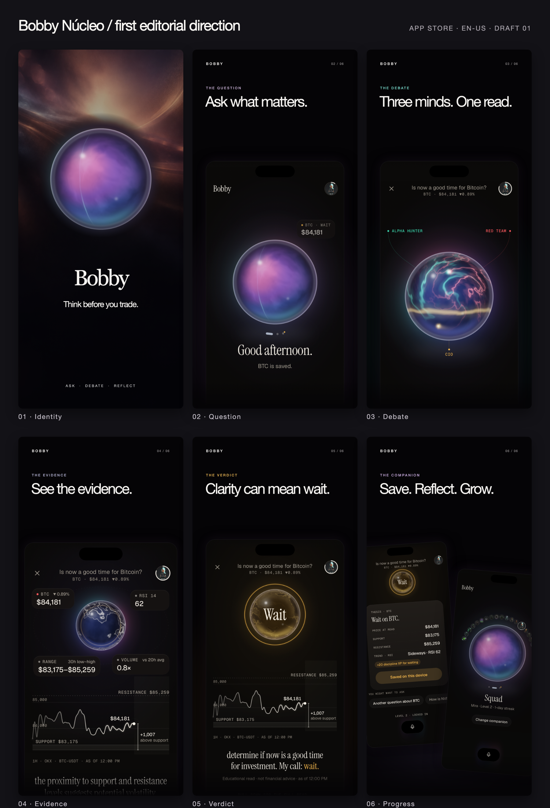

# Bobby Núcleo — editorial App Store screenshots (draft 01)

Reference: [Open on Recent](https://recent.design/i/b2uk51z-open). The borrowed principle is its pacing: an atmospheric opening, then spare black slides with one short thought and large product imagery. The Open app, its wording, ratings, awards, logos, and photography are not used here.

| Slide | Message | Product image |
|---|---|---|
| 01 | Bobby · Think before you trade. | Deep Core sphere cropped from the actual home capture, over a new abstract atmosphere |
| 02 | Ask what matters. | Home and external companion avatar |
| 03 | Three minds. One read. | Alpha Hunter, Red Team, and CIO in the sphere |
| 04 | See the evidence. | BTC price, RSI, range, volume, and chart |
| 05 | Clarity can mean wait. | Educational Wait verdict |
| 06 | Save. Reflect. Grow. | Saved thesis and Squad, shown as two distinct app states |

The UI comes from the six unmodified build-40 source captures in `../build-40/screenshots/en-US/`; the compositions only scale, crop, or dim them. No prices, performance, reviews, award badges, features, or app controls were invented. `assets/cover-atmosphere.png` is original abstract campaign art. There is no character inside the sphere.

This is an **EN-US visual draft**, not a submission package. Before submission, recapture the approved next build and check every headline against its final screen. A Spanish storefront set should use Spanish in-app captures as well as Spanish headlines. The uploaded build 40 does not contain the audit fixes.

Each exported PNG is 1320 × 2868 pixels with no alpha channel. Edit `index.html` to change layout or copy, then run `python3 render.py` from this folder to rebuild all six PNGs and `contact-sheet.png` with local Chrome. `python3 render.py --only 03` and `python3 render.py --contact` render selected outputs.
