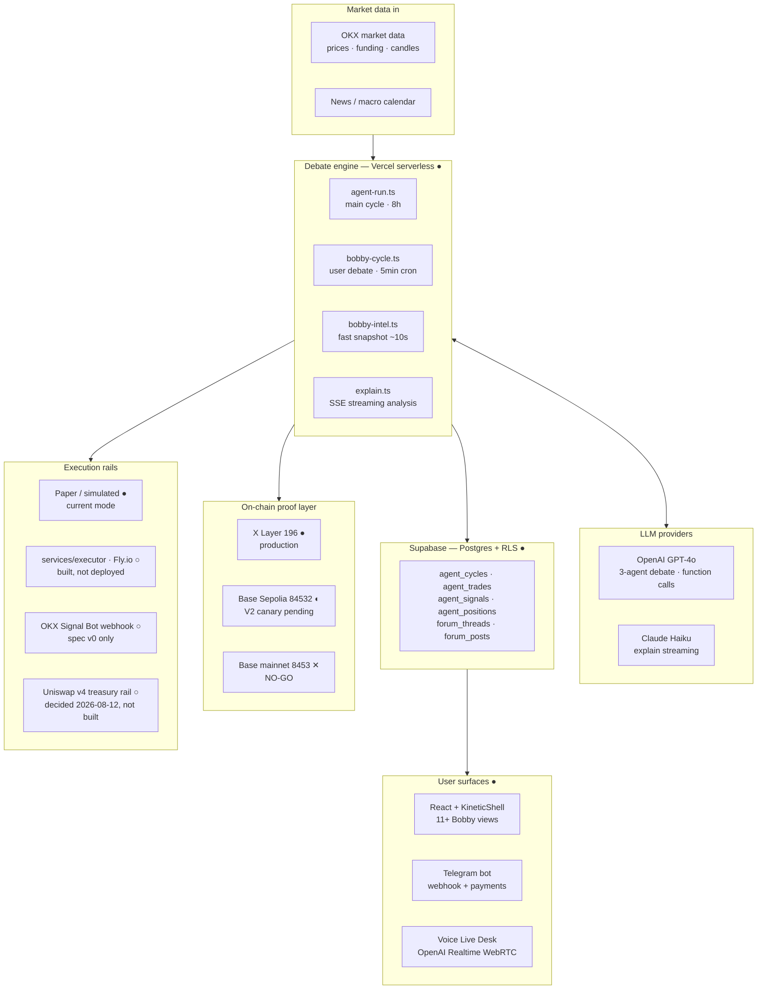
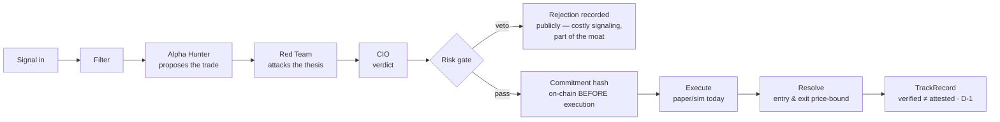
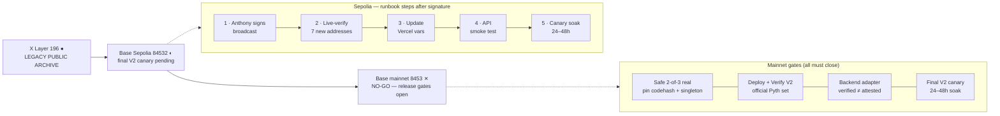

# Bobby Protocol — Architecture & Status

**As of 2026-08-14** · Base release candidate · TrackRecord V2 reviewed
(`53d1f4c`) with mutation-sensitive invariant coverage (`763d765`)

Legend: **●** live · **◐** canary/partial · **○** decided or spec'd, not built · **✕** gate (NO-GO until closed)

---

## 1. System overview

**Rule of the house:** Bobby trades paper/simulated only. Real broadcasts, deploys
and env changes are executed by Anthony — the agent prepares, never fires.

## 2. The debate cycle (the product)

Each role maps to a distinct on-chain address (manifest `roles`): `alpha`, `red`,
`cio`, `keeper`, `arbiter`, plus a 2-of-3 `resolvers` quorum. Positioning: this
proof-of-*process* (debate trail + published vetoes + price-bound results) is the
differentiator vs Base agent competitors — see
[base-competitive-landscape.md](strategy/base-competitive-landscape.md).

## 3. Chains & deployment pipeline

## 4. Component status

| Component | State | Next step |
|---|---|---|
| Debate engine (agent-run / bobby-cycle / bobby-intel / explain) | ● live | — |
| Frontend (KineticShell, 11+ views) + Telegram + Voice | ● live | — |
| Supabase (Postgres + RLS) | ● live | — |
| X Layer record API (auth fail-closed, hardened) | ● code ready | Prod still runs pre-hardening build — guard activates when Anthony promotes a deploy |
| Base Sepolia contracts (r8, block 45364125) | ◐ historical canary, superseded | Final V2 rehearsal must redeploy the reviewed release candidate |
| TrackRecord V2 security baseline | ● code complete | ABI frozen; P1 fixed; mutation-sensitive invariant proves regression coverage |
| DeployBase + Verify V2 | ◐ in progress | Pin official Pyth set, deploy V2 and reconcile manifest/ownership |
| Backend TrackRecord V2 adapter | ◐ in progress | Wire VERIFIED and ATTESTED paths against the frozen ABI |
| Executor service (`services/executor/`, Fly.io) | ○ built | `fly deploy` by Anthony |
| OKX Signal Bot rail | ○ spec v0 | [execution-controls.md](signal-bot/execution-controls.md) → Demo Trading PoC after soak |
| Uniswap v4 treasury rail (V4Quoter + Universal Router, hookless pools) | ○ decided 2026-08-12 | Implement in mainnet round ([plan](plan-migracion-base.md)) |
| TrackRecord v2 (entry+exit oracle evidence, separate attested ledger) | ● release candidate | Deploy/verify and complete final Base Sepolia canary |
| Safe 2-of-3 (owner on 8453) | ✕ gate | Create, audit, pin codehash + singleton |
| Final contract/security review | ✕ gate | Close any remaining findings on the exact deployment diff |
| Copy Trading / paid signals | ✕ phase 2 | Only after stable execution + net-of-fees track record + legal review |

## 5. The 7 contracts (Sepolia manifest `84532.json`)

| Contract | Role |
|---|---|
| `BobbyTrackRecordV2` | Entry/exit oracle evidence, challengeable stops and a separate attested ledger |
| `BobbyConvictionOracle` | Signal/conviction commitments published pre-execution |
| `BobbyAgentEconomyV2` | Debate fees & protocol economy stats |
| `BobbyAgentRegistry` | Agent identities + registration stake |
| `BobbyIntentEscrow` | Intent attestation ledger — **never** mixed with price-verified stats (D-1) |
| `BobbyAdversarialBounties` | Bounties for adversarial findings |
| `HardnessRegistry` | Debate hardness scoring |

---

**Current bottleneck, in one line:** TrackRecord V2 is reviewed, but its exact
Deploy/Verify integration, backend adapter, Safe ownership and final Sepolia
rehearsal still need evidence. Mainnet remains correctly NO-GO behind those
gates. The operational checklist is
[`release-readiness.md`](release-readiness.md).
