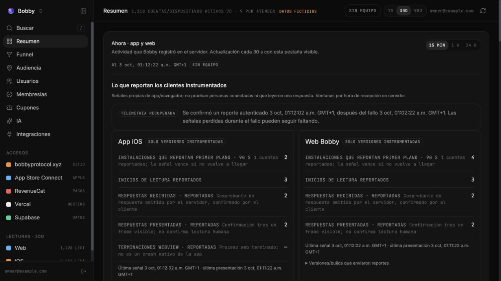
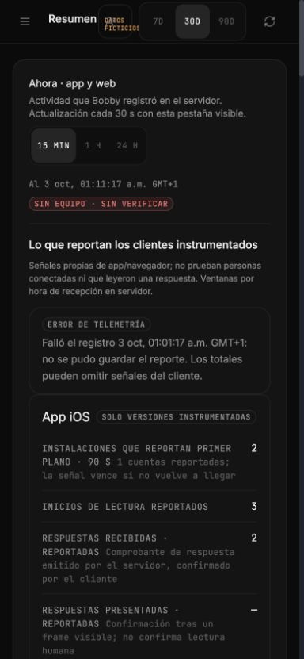

# First-party live telemetry: reviewable local implementation

Status: implemented and tested locally; not deployed or distributed. The dashboard goal remains open.

This branch, codex/bobby-client-telemetry, builds on the immutable dashboard phase1 commit 321f46047a50cc19eb894c9e859706c160417a83. The original user checkout and unrelated changes were not modified. The remote main reference was verified at 1d565e7250058f825a3514d6f7dbd91ffd4c2512 after implementation. No push, database production write, paid analysis, email send, TestFlight upload or distribution occurred.

## Result and evidence boundaries

The dashboard's first stage optimizes and bounds administrative reads, separates frequent first-party snapshots from delayed provider data, excludes the team's activity by default, and distinguishes verified money and observed server outcomes from incomplete evidence. See ../dashboard-live-2026-10-03/README.md.

This second stage adds a first-party client-report endpoint, installed-client lifecycle reporting, and response receipt/presentation acknowledgements to iOS and web. Presence expires after ninety seconds and refreshes through visible-client heartbeats. Every metric distinguishes source, scope, time and instrumented build coverage. Anonymous installations and verified accounts remain different measures.

A completed server request, consumed credit, received response, presented response and human reading are different claims. Only successful desk completions can issue a purpose-specific HMAC receipt, bound to the installation, owner, platform and request. Client acknowledgement after presentation remains a client report; it does not independently prove human reading. Old installed clients remain unmeasured. No native-crash collector or global app-success rate is claimed.

The endpoint enforces origin, request size, supported platform, verified credentials when supplied, deduplication and bounded storage/auth/body decoding. Wallet proof can establish authenticated recovery without adding a registered-account count. Client timestamps preserve cross-session order under the bounded thirty-second positive clock skew; presence expires from the earlier capture/receive time. Stale, reordered and duplicate reports cannot revive a closed epoch.

The native emitter uses an in-memory bounded queue, captures monotonic order across sessions, discards old credentials/receipts on account changes and emits presentation only after the current result's visible frames. The web emitter uses one stable installation identifier shared with access requests, a four-second transport deadline, one retry with original event metadata, identity cancellation and no local-development/admin reporting by default. Static home/Nucleo pages use a small first-party bundle without an added analytics SDK.

## Local verification

| Check | Result | Practical limit |
| --- | --- | --- |
| API ingestion and signed receipts | 97 assertions passed | Offline service responses; no production persistence |
| Actual desk receipt paths | 278 assertions passed | Offline model responses; no billable analysis |
| Web runtime, transport, normalization, isolation and visible-frame checks | 59 assertions passed | Scripted DOM/network; no deployed browser session |
| Existing admin UI normalization regressions | 191 assertions passed | Source contract checks |
| Static Nucleo web transport | 107 assertions passed | Local fixtures |
| Native visible presentation JavaScript | 4 tests passed in the final combined suite | Local bridge fixture |
| iOS XCTest | 64 tests passed on iPhone17Pro / iOS26.1 simulator | Debug 1.6 (54), no physical device/release proof |
| Changed API/admin TypeScript checks | Passed | Broader existing Nucleo graph has baseline type errors described in web-source.md |
| Changed TypeScript source lint | 25 files passed | Scoped sources; repository-wide lint not claimed |
| npm run build | Passed with the final package integration | Local production bundle; no deployment |
| Desktop/mobile visual QA | 1280x720 and 390x844; no horizontal overflow | Explicitly fictitious fixtures |

The complete local live snapshot was optimized on one fixed-clock synthetic fixture: median 328 ms before and 44 ms after, with the entire JSON identical. The fixture contained 110,006 retained events, 10,000 recent events, 2,000 presence installations and eight build cohorts. Recent aggregation is bounded to indexed 24-hour data; historical latest-kind and build observations retain indexed probes. This is a local SQL improvement, not a production endpoint latency or capacity result. See sql-performance.json for samples, plans and buffers.

**170 telemetry PostgreSQL assertions passed** after the final historical-query optimization. Database checks and updated query evidence are recorded in sql-contract.md and postgres-console.txt. The unchanged phase1 chain previously passed 339 checks in the same clean local database; telemetry checks were rerun only for relevant SQL changes. Native source and XCTest-log hashes matched ios/Bobby/docs/client-telemetry-evidence.json after all native edits. These results do not establish physical iPhone behavior, production safety, capacity or a purchase lifecycle.

The final combined API/web/presentation console is client-tests-console.txt. Build output is build-console.txt. The dashboard fixture was tested in normal and partial-source states; missing iOS presentation is a dash, source failure remains visible, and recovered source health preserves the possible loss of signals. One-hour selection changes client window totals. Mobile source notices put the label above the body for readability.

## Build and publication dependencies

npm run build now creates public/client-telemetry.js before Vite copies static assets. The deployment-specific generated file is ignored in Git. VITE_APP_BUILD falls back to the Git deployment's VERCEL_GIT_COMMIT_SHA; neither the SPA nor the static bundle substitutes a dirty local HEAD or the package placeholder version. Existing unknown version/build remains unknown. Static HTML source changes are generated with python3 nucleo/build.py --web and tracked.

Apply the phase1 migration 20261002231124_admin_truth_live_snapshot.sql before 20261002235202_first_party_client_telemetry.sql. Production migrations must use the approved Bobby Supabase project qbvdqkknnuweatptjohi. Do not replay the five reconciled historical production migrations as new migrations. Build and publish through main's Git integration; do not bypass the source guard or replace the production alias with a CLI side-branch deployment.

The receipt issuer uses the existing configured RATE_LIMIT_SALT with purpose separation and has no insecure default. A missing signing key means no receipt coverage. The native source version/build remains 1.6 (54); this number is a source/simulator observation, not a proposed upload number or evidence of the currently installed App Store build. Publishing the backend cannot instrument older installed builds.

## Remaining acceptance

1. Obtain the still-pending authorization for production database/backend publication of the concrete reviewed changes. Recheck the source/main and migration state immediately before the approved action.
2. Apply the new migrations in order, publish the exact Git/main commit, and verify actual admin endpoint authentication, response freshness, provider errors, team scopes and database facts in production.
3. Exercise real first-party web foreground/background and received/presented transitions with the approved deployed commit. Verify matching scoped database/dashboard observations and ninety-second expiry; synthetic fixtures cannot close this gate.
4. Prepare a separately approved instrumented iOS release with a unique build number and matching privacy/disclosure metadata. Install that exact build on a physical iPhone and verify foreground/background, suspension, account switch, denied/failed/abandoned reads and actual response presentation against the deployed receipts.
5. Verify real provider/billing discrepancies and cost coverage separately. App Store/provider publication delays, incomplete historical ledger coverage and receipt replay tests do not establish a real purchase, refund, restore or broker execution lifecycle.

The original dashboard goal cannot be marked complete until these production and installed-app evidence gates are closed.

