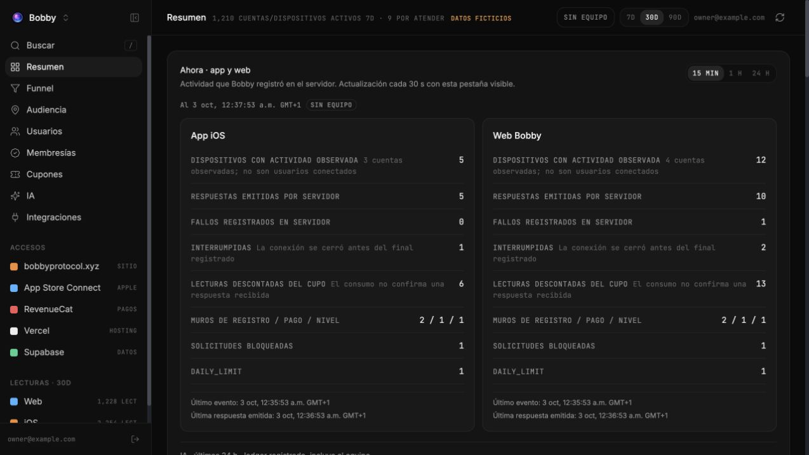

# Bobby admin: operational visibility and truthful metrics

Prepared 2026-10-03 in the isolated `codex/dashboard-live-truth` branch, based on deployed/main commit `1d565e7250058f825a3514d6f7dbd91ffd4c2512`. Production database: `qbvdqkknnuweatptjohi`. No production writes, deployment, real payment, metered generation or email send were performed during validation.

## Result ready for review

The summary opens with separate iOS and web windows (15 minutes, 1 hour, 24 hours), refreshed every 30 seconds while visible. It displays observed devices/accounts, server-recorded completed responses, failures, interrupted connections, quota consumption, refusals and the latest event/response timestamps. Provider/model p50/p95 measures provider-call latency only. Refresh time is distinct from activity time.

The same deterministic insight rules serve the UI, API, generated plan and digest. Rules respect missing coverage, sample size, team scope, delayed sources and unreconciled revenue. Paid plan generation is on demand, cached and locked; generated figures must match supplied facts. Digest/alert concurrency and deduplication use atomic claims. Email acceptance is recorded as acceptance, not delivery.

Known paid production memberships, gifts, tests and unverified access remain distinct. Unknown environment/period keeps entitlement access without inventing paid status. Receipts are recorded independently of membership reconciliation. Stripe charge/refund IDs are replay safe; pending/failed refunds and unknown currency conversion never become USD revenue. Unowned receipts, unconverted events and team-inclusive totals have separate labels. Cost/net/ROI are based on recorded evidence and are not complete business profitability.

## Endpoint and source coverage

All 12 authenticated GET views return freshness/partial/source metadata and use bounded source reads. GET budget is 15 seconds, including bounded authentication and persistent rate-limit reads; admin POST/cron budget is 50 seconds under the 60-second platform limit.

| `/api/admin?view=` | Behavior |
| --- | --- |
| `me` | Authenticated admin identity; optional email read |
| `overview` | Fast core overview/growth/network RPCs; independent comparison request; no slow external-provider fanout |
| `live` | Aggregate service-only RPC, separate iOS/web windows, bounded to 10 seconds |
| `integrations` | Independent provider bundle refreshed every 5 minutes; source errors and coverage retained |
| `lifecycle`, `audience` | Cohort/outcome/geo coverage preserved; unavailable denominators stay unknown |
| `users` | Finite pagination and bounded search; account/install/team provenance |
| `internal`, `members` | Indexed team graph and membership categories; explicit scope |
| `costs`, `coupons`, `actions` | Authenticated reads with source metadata; existing audited mutations retained |

Client requests do not overlap. Period/team changes and unmount cancel requests; late responses cannot overwrite the selected scope. Failed refreshes retain prior data and expose their error/staleness. Apple cache reads are batched and newest-first with a 10-second budget; unavailable daily reports remain gaps. Google Search Console retains provisional Pacific-time coverage and missing-day gaps. RevenueCat V2 requires the explicitly selected project.

## Evidence and limits

| Area | Verified | Still required |
| --- | --- | --- |
| Production facts | Read-only SQL and authenticated dashboard compared; actual migrations and deployed base identified | Verification of the new version after deployment |
| API and billing behavior | Offline upstream success/error/timeout/body/replay/ordering fixtures, concurrent digest/plan claims, paid-proof regressions | Real production checkout, renewal/refund ordering and device purchase/restore acceptance |
| Database | Actual production predecessor chain, privileges, idempotency, attribution, team exclusion, outcome coverage, local scale fixtures | Apply the one new migration and check live RPC/latency |
| Interface | All eight tabs at desktop/mobile sizes, no horizontal overflow/error boundary, source labels and mock banner | Authenticated production tab checks on the deployed commit |
| App moment-to-moment | Server-observed iOS requests/outcomes and activity timestamps | Native open/presence/crash/build and rendered-response telemetry; installed-build/device verification |
| Providers/cost | Source-specific timestamps/errors; recorded LLM spend | Provider publications remain delayed; unrecorded costs and balances cannot be inferred |

A server `read_delivered` event means the server completed its response; it does not prove that the phone/browser rendered it. Observed accounts/devices are not verified unique humans or online presence. Zero recorded failures does not prove whole-app health. The UI states these limits explicitly. Native follow-up pointers and physical-device acceptance are in [native-telemetry-next.md](native-telemetry-next.md).

Production facts/timings: [live-truth.md](live-truth.md). SQL reconciliation/results: [sql-regression.md](sql-regression.md). Independent backend findings/retest: [backend-review.md](backend-review.md). Local synthetic timings are database samples, not production endpoint latency/capacity proof.

## Validation completed

- `npm run build`: API/admin TypeScript checks and Vite/PWA production build passed. [Console](build-console.txt). Existing large-chunk notices remain.
- `npm run test:admin-live`: 95 API + 191 UI + 259 desk/outcome + 118 insight/plan/digest + 69 Stripe truth checks passed (732 total, offline).
- `npm run test:admin-live-pg`: 339 actual PostgreSQL assertions passed against local PG17.11 and the reconciled production migration chain.
- Existing admin API 192, Stripe paid-proof 44, RevenueCat 209, desk levels 129, desk debate 133, user memory 120, LLM ledger 10, API security 51 and iOS/review remediation regressions passed.
- ESLint `--quiet` passed all 53 changed TypeScript files; `git diff --check` passed.
- CI now runs the new API/UI/insight/billing and PostgreSQL suites. Remote CI has not run until a branch is pushed.

Screenshots use explicitly labelled fictitious data and prove local layout only:

[Mobile fixture](local-mobile-fixture.jpg)

## Publication sequence requiring production authorization

1. Refresh the deployed commit and migration registry; rebase/reconcile if either changed. Confirm existing provider configuration, including explicit `REVENUECAT_PROJECT_ID`; never choose an arbitrary RevenueCat project. Check Stripe refund event selection (`refund.created`/`refund.updated`, with `charge.refunded` reconciliation also supported) and refund-read permissions on the existing key. Remote environment values and webhook selection were not verified during this local pass.
2. Through Supabase MCP, apply **only** `20261002231124_admin_truth_live_snapshot.sql` as the new migration. The five predecessor files were already applied in production; they reconcile Git history and must not be reapplied as new remote migrations. This preserves function signatures used by production, team graph/device optimizations and service-only privileges. NULL subscription classifications become explicit `unknown`, without revoking access.
3. Publish the tested branch through the repository's Git/main deployment path; attach any created PR to this chat. Do not bypass the production-source guard with a CLI production deployment.
4. Wait for the exact Git commit to serve on `bobbyprotocol.xyz`. Verify authenticated GET views/source metadata, team toggle, the operational windows, billing categories, all eight tabs and error/partial states against fresh read-only database aggregates. Record deployed API latency separately from local SQL timing.
5. Keep the goal active for outstanding native telemetry and installed-device proof; do not claim universal real-time app coverage or end-to-end payment correctness from this dashboard alone.

If deployment fails, roll the application back through Git to the prior serving commit and retain the compatible additive schema. Do not blindly replay old schema definitions: preserve recorded receipts/outcomes and assess database remediation separately. No receipt/account deletion is part of this change.
